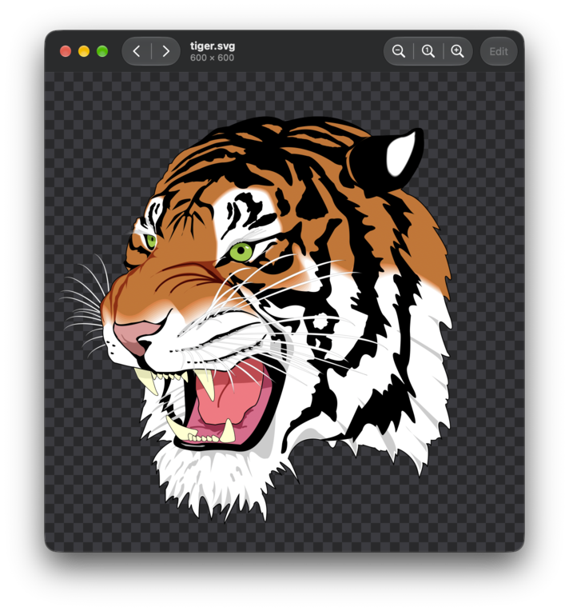

# ImageView

A simple native image viewer for macOS, Windows and Linux that opens common images, animations and
vector drawings, and follows the system light or dark theme.

## Features

- Decode BMP, GIF, ICO, JPEG, PNG/APNG, QOI, and TGA with a custom [image](../../../lib/graphics/image) decoder crate
- Play GIF/APNG animations with frame timings and loop counts
- Render SVG and TinyVG with the shared [vector](../../../lib/graphics/vector) decoder, drawn
  by [imageview-core](../imageview-core) with [bcanvas](../../../lib/graphics/bcanvas): Core
  Graphics on macOS, Direct2D on Windows and Cairo on Linux
- Zoom, pan, and fit images to the window
- Open slow to decode images in a window with a native loading indicator right away
- Automatically refresh an open image when its file changes, without resetting the zoom
- Browse previous and next images in the same folder
- Drop an image onto a window to show it there
- File manager previews and thumbnails for supported formats

### macOS

- A toolbar in the titlebar with previous and next image and the zoom commands, and the
  image size below the file name
- Print images at their natural size or scaled to fit, and reopen them from Open Recent
- Quick Look [preview](../imageview-macos-preview) and [thumbnail](../imageview-macos-thumbnail)
  extensions

### Windows

- A WinUI 3 window from one XAML island, through handwritten Windows App SDK bindings without
  extra crates: a header bar with the toolbar buttons in the title bar, like a GTK header bar or
  a unified macOS toolbar, with Mica and tall caption buttons, above a ScrollViewer with overlay
  scroll bars, touch and touchpad pinch zoom and panning by dragging. Vector images are drawn
  again at the magnification they settle at, so they stay sharp
- File Explorer thumbnails and preview pane from the [shell extension](../imageview-windows-shell),
  which the MSIX package registers without changing the registry
- Light and dark themes, also for the scroll bars and caption buttons

### Linux

- Native GTK3 controls for previous and next image, zoom out, actual size, and zoom in,
  with a header bar on GNOME (including Ubuntu), Budgie, and Pantheon, and image dimensions
  beneath the filename. Other desktops use a normal titlebar showing `filename (widthxheight)`
  and an inline toolbar containing only buttons.
  Detection uses `XDG_CURRENT_DESKTOP` on both X11 and Wayland
- A freedesktop thumbnailer: `ImageView --thumbnail -s SIZE INPUT OUTPUT` writes a PNG
  thumbnail, without starting GTK
- `cargo xtask install` installs the binary, the [desktop entry](meta/freedesktop/.desktop),
  the [thumbnailer](meta/freedesktop/.thumbnailer) and the [MIME types](meta/freedesktop/mime.xml)
  of QOI and TinyVG into the user's data directory

## macOS Entitlements

The main app does not use the `com.apple.security.app-sandbox` entitlement because `com.apple.security.files.user-selected.read-only` only permits reading the selected image, not the other images in the same folder. ImageView needs access to those files to browse to the previous and next images.

## Screenshot

## License

Copyright © 2026 [Bastiaan van der Plaat](https://bplaat.nl/)

Licensed under the [MIT](../../../LICENSE) license.
