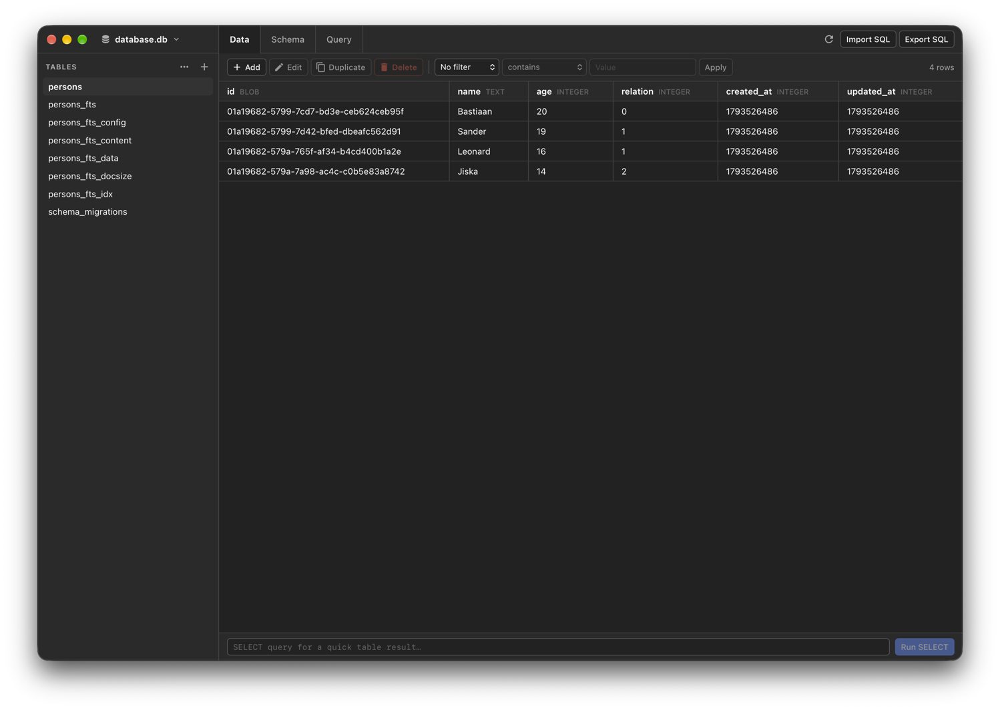

# Sequel Explorer

A lightweight SQLite and MySQL database explorer and editor built with
[bwebview](../../../lib/ui/bwebview) and [bsql](../../../lib/data/bsql). It combines fast table
browsing, direct row editing, a full read/write SQL workspace, and MySQL user management in a
compact native desktop application.

## Features

- **Connections**: open SQLite files or connect to MySQL over TCP or a Unix socket, with passwords
  saved in the system credential store
- **Data**: browse, sort, filter, and incrementally load tables, then add, edit, duplicate, and
  delete rows from the toolbar, context menu, or by double-clicking a row
- **Structure**: create, duplicate, truncate, and delete tables and MySQL databases, and edit
  columns, keys, indexes, and foreign keys
- **SQL**: run read and write statements in one transaction in the Query workspace (MySQL
  commits schema changes implicitly), and import or export complete databases as SQL scripts
- **Administration**: manage MySQL users and their database privileges

## Screenshot

## macOS Entitlements

The `com.apple.security.app-sandbox` entitlement is not used because SQLite databases can require
access to accompanying `*-shm` and `*-wal` files next to the selected `.db` file.

For stable Keychain authorization across rebuilds, bundles use the first valid system code-signing
identity. Set `CODESIGN_IDENTITY` or `package.metadata.bundle.signing_identity` to select one
explicitly. Ad-hoc signing remains the fallback when no certificate is available.

## License

Copyright © 2026 [Bastiaan van der Plaat](https://github.com/bplaat)

Licensed under the [MIT](../../../LICENSE) license.
