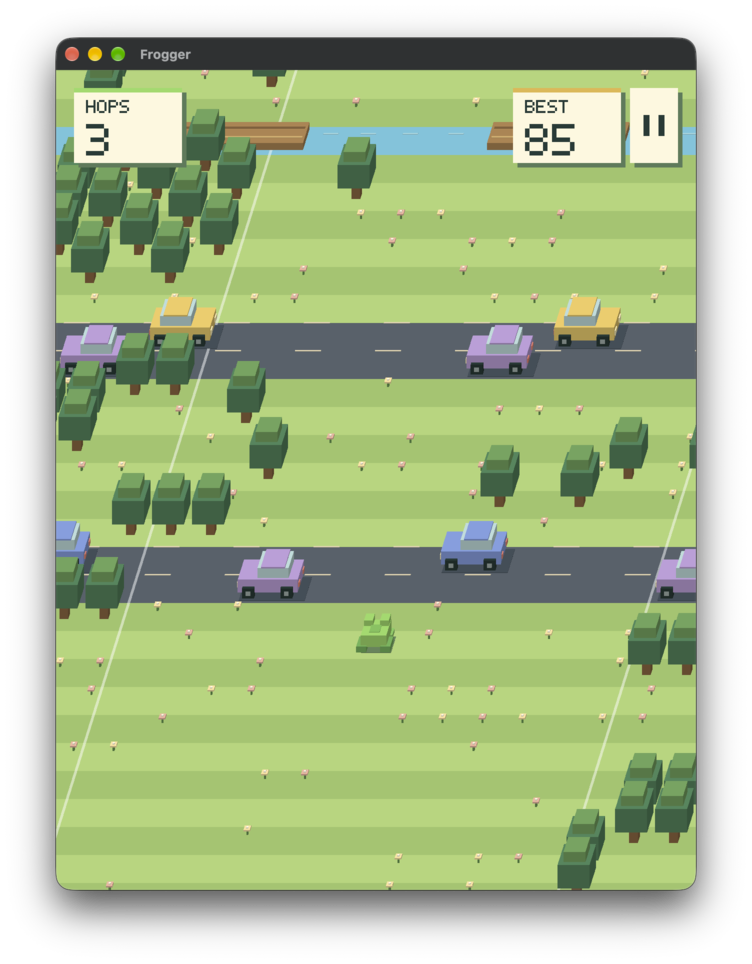

# Frogger

A native voxel crossing game built with Rust, [bwindow](../../lib/ui/bwindow),
and [bwebgpu](../../lib/graphics/bwebgpu). Hop past cars and trucks, ride logs,
and watch for trains. Crossings get busier as you advance, and your best score
is saved between sessions.

Retro sound effects are made with [sfxr](../../lib/audio/sfxr) and mixed by
[baudio](../../lib/audio/baudio): hops, logs, crossing bells, train horns, and the
countdown. The speaker button next to pause mutes them.

Window position and size are restored by bwindow; best scores use the native
preferences store.

```sh
cargo run -p frogger
```

## Controls

| Action         | Keyboard            | Touch                       |
| -------------- | ------------------- | --------------------------- |
| Forward        | Up / W              | Tap or swipe up             |
| Left / right   | Left / A, Right / D | Swipe left / right          |
| Back           | Down / S            | Swipe down                  |
| Start / retry  | Space / Enter       | Tap                         |
| Pause / resume | P / Escape          | Tap the pause icon / dialog |
| Mute / unmute  | M                   | Tap the speaker icon        |
| Restart        | R                   | Retry after game over       |

Mouse clicks hop forward; mouse drags and trackpad swipes use the same directional
controls as touch. Each trackpad gesture makes one hop.

The game pauses when it loses focus. Keep moving forward: after five seconds
without progress, a countdown warns you before time runs out. White lines mark
the playable edges.

Mobile uses a closer view that follows the frog sideways near the edges. Traffic,
logs, and trains continue beyond the viewport so they enter and leave smoothly,
including in wide desktop windows.

## Screenshot



## License

Copyright (c) 2026 Bastiaan van der Plaat.

Licensed under the [MIT](../../LICENSE) license.
