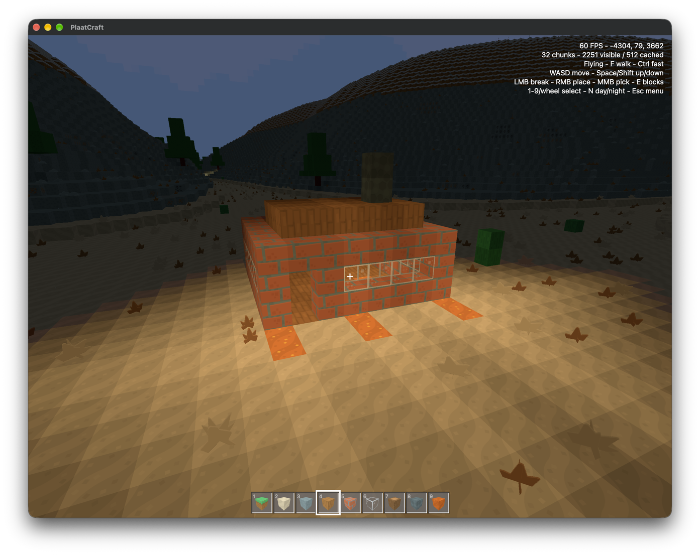

# PlaatCraft

A Minecraft like voxel sandbox written in Rust for macOS, Linux, Windows, iOS, and
Android, built with [bwindow](../../lib/ui/bwindow), [bcanvas](../../lib/graphics/bcanvas)
and [bwebgpu](../../lib/graphics/bwebgpu). The game itself lives in the
[plaatcraft-engine](../plaatcraft-engine) crate, which the [Wii port](../plaatcraft-wii) shares.

## Features

- Endless terrain with biomes, trees, plants, ores, and flowing water and lava
- Break and place blocks from a hotbar and an inventory of every block, slabs and stairs
- Build big with `/pos1`, `/pos2`, `/fill`, and `/clear`, and take changes back with `/undo`
- Walking, swimming, and flying, day and night
- Multiple worlds that are saved automatically and also play on the Wii
- LAN multiplayer like Minecraft, with the desktop, mobile, and Wii versions together
- Synthesized sound effects, settings, and touch controls on iOS and Android

## Run

From the workspace root:

```sh
cargo run --release -p plaatcraft
```

Package it with [cargo-bundle](../../tools/cargo-bundle) for macOS, iOS, Android, or
Windows, add `--run` to install and start it:

```sh
cargo bundle --path games/plaatcraft --ios --run
cargo bundle --path games/plaatcraft --android --run
```

## Multiplayer

Pause a world and choose **Open to LAN**, other players on the network then find it in
**Multi Player**, or join by address with **Direct Connect**, like `192.168.1.5`. Guests
continue where they left the world. It uses TCP and UDP port 47820 and UDP port 47821 for
finding worlds.

## Controls

| Desktop             | Action                                  |
| ------------------- | --------------------------------------- |
| Mouse / WASD        | Look around and move                    |
| Space / Shift       | Jump or swim up, sneak; fly up and down |
| Ctrl                | Run or fly faster                       |
| Left / Right mouse  | Break or place a block                  |
| Middle mouse        | Pick the targeted block                 |
| 1 - 9 / Mouse wheel | Select a hotbar slot                    |
| E                   | Open the inventory                      |
| T / Enter / /       | Open the chat, `/` starts a command     |
| Escape              | Pause and return to the menu            |

The chat sends messages and runs commands, `/help` lists them. On touch screens, drag on
the left to move and on the right to look, tap to place and hold to break.

## How it works

Each world is a SQLite file named after the world in the app data directory. Like in
Minecraft it stores every loaded chunk, so updates of the world generation never change a
saved world. Playing a world starts an integrated server that owns it, LAN guests talk to
the same server.

## Screenshot



## License

Copyright © 2026 [Bastiaan van der Plaat](https://github.com/bplaat)

Licensed under the [MIT](../../LICENSE) license.
